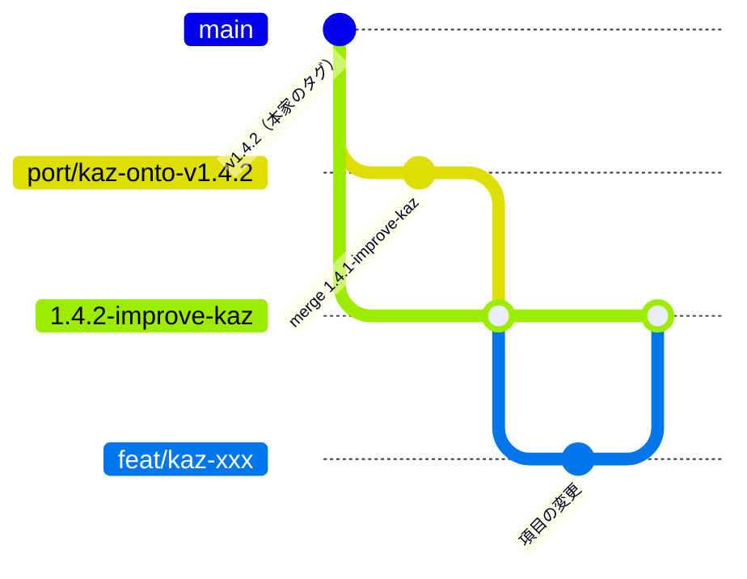

# 本家の新しい版へ kaz を載せる手順

本体 `tongsama/juicefs` の kaz の改修を、本家（juicedata/juicefs）の新しい版へ載せるときの手順です。本家への PR は出しません。2026-10-27 に v1.4.2 で行った作業（[調査報告](../../inspection/upstream_v1.4.2/2026-10-26/port-investigation-ja.md)）をもとにしています。

## ブランチの形



（図の `main` は本家のタグの位置を表すための枝で、実際のブランチ名とは関係ありません。）

- `main` は本家の写しです。kaz の commit は載せません。
- 本家の新しいタグごとに `<版>-improve-kaz` を切ります。前の `<版>-improve-kaz` は凍結し、配布した版のビルド元として残します。
- `<版>-improve-kaz` には直接 commit しません。項目ごとにブランチ（`port/…`、`feat/kaz-…`、`fix/…`、`refactor/…`、`docs/…`）を切り、`--no-ff` で merge します。
- 前の kaz の取り込みは `port/kaz-onto-v<版>` で行います。新しいタグから切り、前の `<版>-improve-kaz` を merge します。

## 手順

1. 本家を取得する: `git -C juicefs fetch origin --tags`
2. 衝突を先に数える（作業ツリーには触れない）。

   ```bash
   sh docs/development/upstream-sync/preview_conflicts.sh juicefs 1.4.2-improve-kaz v1.4.3 v1.4.2
   ```

   4 番目の引数は、前の本家の版です。前の版と新しい版のあいだで元から起きる衝突を基準にして、kaz が原因で増えた衝突ブロックの数を出します。
3. 意味の衝突を探す。テキストの衝突がなくても、ビルドが壊れることがあります（v1.4.2 では format の `atomic.Pointer` 化で `tkv.go` とテストが壊れた）。本家の変更から、kaz が使う型・関数の改名や署名の変更を探します（`git diff <前の版> <新しい版> -- pkg/ cmd/`）。
4. worktree を作り、新しいタグから `<版>-improve-kaz` と `port/kaz-onto-v<版>` を切る。`juicefs/` の checkout（本番のビルド元）は動かしません。
5. port のブランチで、前の `<版>-improve-kaz` を `git merge --no-commit` する。rerere が有効なので、同じ衝突は前回の解消が自動で当たります。当たった結果も必ず読みます。
6. ビルドとテスト（Go 1.25.11、`TMPDIR` は root filesystem 上、Redis が要るテストは一時コンテナで 127.0.0.1:6379）。
7. 変更が保たれたかを確かめる。「前の kaz → port」の差分が「本家の前の版 → 新しい版」の差分と一致し、ずれが意図した手当てだけであることを見ます。
8. commit と、`<版>-improve-kaz` への `--no-ff` の merge は、ユーザーの確認後に行う。push と release も同じです。

## rerere

- 本体リポジトリで `rerere.enabled=true` にしてあります（2026-10-27）。`rerere.autoUpdate` は既定（false）のままにしています。自動で当たった解消も、index に載せる前に読むためです。
- 過去の解消は `sh /usr/share/doc/git/contrib/rerere-train.sh <merge の範囲>` で学習できます。作業ツリーがきれいな worktree で実行してください（HEAD を一時的に動かすため）。2026-10-27 に `7255adb5^..7255adb5` で 4 件を学習しました。
- rerere が効くのは、まったく同じ衝突の hunk だけです。本家の周りの行が変われば、解き直しが要ります。

## upstream のファイルへ kaz の差分を入れるときの規則

衝突を減らすための規則です。調査リポジトリの `AGENTS.md` のコメントの規則の例外（2026-10-27 に追加）と対応しています。

- upstream の関数の直前に doc コメントを足さない。kaz が変えた行の上に、関数の中で `// kaz:` の行コメントを書く。
- 新しい関数・型は `*_kaz.go`（同じパッケージ）に置き、upstream のファイルには hook の呼び出しだけを残す（2026-10-27 実施）。
- 設定・状態のフィールドは、埋め込み struct（`KazChunkConfig`、`KazMetaConfig`、`KazVfsConfig`、`kazStoreState`、`kazMetaState`、`kazDiskState`、`kazFileWriterState`）に足す。upstream の struct には埋め込みの 1 行だけを置く。`TestKazEmbeddedFieldsNotShadowed` が名前の重なりを検出する。
- フラグは `cmd/kaz_flags.go`（`kazStorageFlags`、`kazDataCacheFlags`）に足す。upstream のフラグの Usage を変えるときは `kazSetFlagUsage`（見つからなければ panic）。
- `meta.Meta` interface にメソッドを足さない。任意の interface（例 `KazSliceWriter`）を型アサーションで使う。メッセージの番号は本家と重ならない値にする（`RetireSlice = 1<<16+1`）。
- `cacheStore` は kaz のコードでは `kazDiskCache`（エイリアス）で書く。1.5 系ではエイリアスの 2 行を `diskCache`／`newDiskCache` に張り替える。
- `flushPageOpt`（`disk_cache_kaz.go`）は本家の `flushPage` の写しに durable の処理を足したもの。本家が `flushPage` を直したら、同じ修正を入れる。
- 計測のログは値型の helper（`pkg/meta/trace_kaz.go`）から出す。書式は調査スクリプトがパースしているので変えない。
- 安全網: `cmd/kaz_refactor_guard_test.go`（`.config` のキーと値、mount のフラグ一式の golden）。差分量は `upstream_diff_size.sh`、衝突は `preview_conflicts.sh` で測る。
- kaz が足すフラグには `kaz-` の接頭辞を付ける。本家のフラグに値を足すだけのもの（`--cache-eviction kaz-2q` など）は除く。
