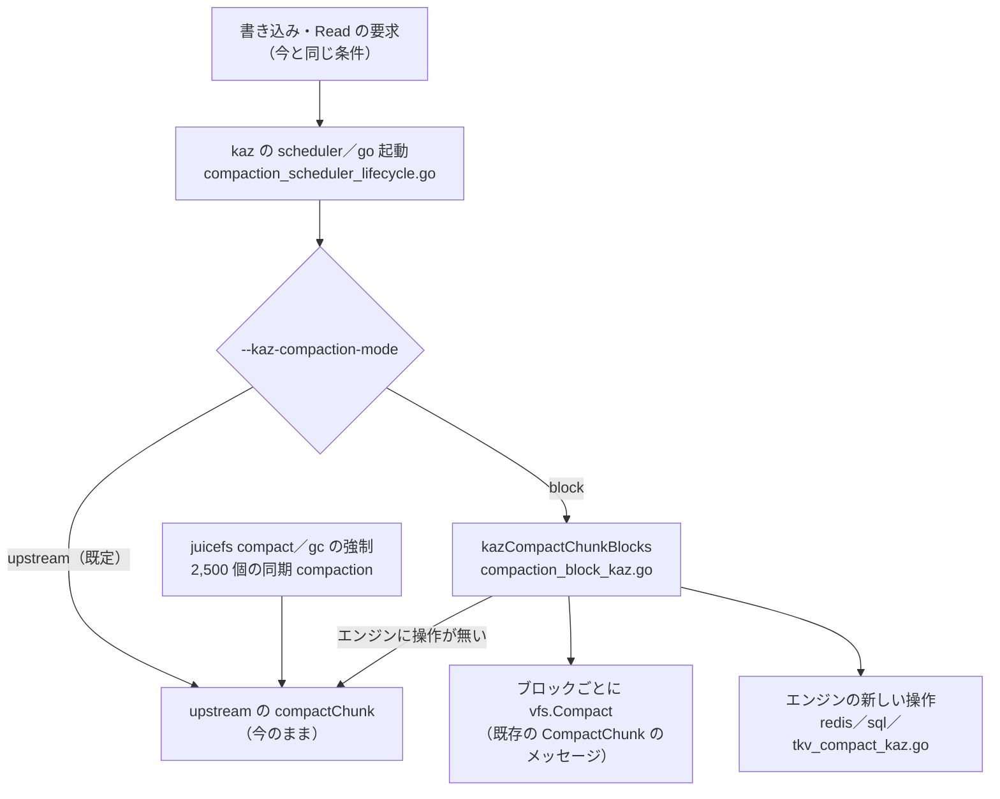

# ブロック単位の compaction（kaz block compaction）設計

日付: 2026-10-14。状態: 実装済み（ユーザー承認の設計、本体 `feat/kaz-block-compaction` 99023190、2026-10-14 に `1.4.1-improve-kaz` へ merge（86321d84）・push 済み）、実機計測済み（報告 §6〜11）。2026-10-14 追加（ユーザー承認、bounded）: block のとき `juicefs compact`／`gc --compact` も block で行い、隠れたデータ 0・ブロックごとの形になるまで繰り返す（既にその形の chunk には何もしない）。`base.go` の `Compact`／`CompactAll` の呼び出し 2 か所を kaz の `forcedCompactChunk` に替えた。2,500 個の同期 compaction は upstream のまま。実装で足した点: ログは upstream と同じ形（`phase=read`／`phase=object`（1 回に 1 行）／`phase=done`、ブロックごとは `compaction block-object`）、件数が max-slices を超え片付ける件が無い chunk も、全体の書き直しで件数が減るときだけ全体を書き直す（max-slices がブロック数＋1 より小さいと mount 時に WARN）、metrics は `kaz_compaction_block_events_total{event}`（結果）と `kaz_compaction_block_amount_total{kind}`（量）。

背景と根拠の数字は [VM の書き込みの偏りと compaction の書き直し](../../inspection/vm_write_hotspot/2026-10-13/report-ja.md)（§6〜9）と [compaction の policy の実機計測](../../inspection/vm_write_hotspot/2026-10-14/report-ja.md) を参照する。前の設計は [kaz compaction policy](2026-10-14-kaz-compaction-policy-design.md)（read の下限だけが残った）。

[事実] は観測またはソースで確認したこと、[推論] は推定、[未確認] は確かめていないこと。

## 1. 目的と条件

### 目的

VM のディスクイメージ（qcow2）を置いた JuiceFS で、compaction の出力の PUT を減らし、PUT の総数を下げる。今の compaction は chunk（64 MiB）の先頭の大きい slice しか飛ばせず（`skipSome`）、残りを丸ごと書き直す（PUT 約 16 件）。書き込みが 4〜20 KiB の数百件でも、64 MiB を書き直す。変化したブロックだけを新しい slice として書けば、compaction の PUT が減る。

### ユーザーの方針（会話で確認）

- **upstream の変更に強いコード**にする。upstream 由来のコードの変更を最小にし、判断は kaz 専用のファイルにまとめ、テストは外から見える振る舞いで書く。変更が大きいので、できるだけ外に出して upstream の変更に備える。
- **今の compaction（upstream の方式）は捨てない。** オプションで選べるようにし、既定は今の方式。オプションの名前は `--kaz-…`。
- **メタデータのエンジンは 3 つ（Redis・SQL・TKV）すべて**で動かす（本番は Redis）。
- 全体を書き直すときも、**ブロックごとの slice に切る**。
- 方式は案 1（kaz の振り分けの関数＋エンジンごとの kaz のファイル。`base.go` は変えない）。
- まだリリースも push もしない。

### 守ること

- compaction は、writeback の staging にあるアップロード待ちの小さな slice をまとめて片付け（`Retire`）、その PUT を省いている。2026-10-14 の計測ではこの効果が PUT の総数を大きく左右した（片付けの割合 52%→71% で PUT の総数 −52%）。**ブロック単位にしても、片付ける slice の集合と compaction の起動の条件・時点を変えない。**
- 起動の条件（commit の 99 個目ごと・350 個超、Read の `--kaz-compaction-read-min`）、scheduler（inode ごとに 1 本）、同じ chunk の重複を防ぐ `m.compacting` は今のまま。
- 2,500 個の同期 compaction、`juicefs compact`、`gc --compact`（強制の compaction）は upstream のまま。
- fsync、commit の順序、read-after-write、slice の削除（deferred GC、trash の delayed）の経路を弱めない。実際の保存の失敗を隠さない。
- メタデータの形式は upstream のまま（slice の一覧の形、参照数のキー）。block から upstream に戻しても、素の juicefs でも読める。

### 成功の基準

2026-10-14 の C の回（`--kaz-compaction-read-min 100` だけ）と同じ手順で比べて:

- compaction の PUT が大きく減る（見込みは約 −50%、§2）。
- PUT の総数（ゲストの書き込み 1 MiB あたり、freeze した slice を最後まで追った値＋compaction の PUT）が減る（見込みは約 −12〜17%）。
- アップロード前に片付けられた割合が下がらない。
- ゲストの read の速さが目に見えて悪くならない。chunk の slice の件数が上限の中に収まる。
- 参照の無い object が増えない。

## 2. 効果の見積もり [事実：集計、見積もりは推論]

既存の 5 回のログ（DEBUG の固定 prefix と accesslog。2026-10-13〜14 と同じもの）で、compaction ごとに「同じ chunk の前回の compaction の開始以降に書かれたブロック」を数えた。書き込みは `slice freeze`（chunk、off、raw_length）、ゼロの範囲は accesslog の fallocate から取った。スクリプトは `docs/inspection/vm_write_hotspot/2026-10-14/block_estimate.py`、出力は同じ場所の `block_estimate.out`。

信頼できるのは「その chunk の 2 回目以降」の compaction（1 回目はログの開始前の slice の位置がわからない）。

| 回 | 今（PUT） | 範囲（変化したブロックの最初〜最後を 1 slice） | ブロック単位 |
|---|---:|---:|---:|
| A（policy なし） | 481 | 376（−22%） | 207（−57%） |
| B（100/1m/700） | 56 | 48（−14%） | 26（−54%） |
| C（read-min 100、本番の設定） | 231 | 184（−20%） | 123（−47%） |
| D（C＋upload-delay 30s） | 256 | 178（−30%） | 98（−62%） |
| E（C＋upload-delay 60s） | 253 | 145（−43%） | 81（−68%） |

- chunk 1（journald）は毎回 7〜12 ブロックに散り、最初〜最後の範囲はほぼ 16 ブロックになる。範囲の方式は効きにくい。
- PUT の総数に直すと、C で約 −12〜17%、E で約 −27%（compaction の PUT が総数に占める割合から）[推論]。
- 見積もりの限界 [未確認]: 1 回目の compaction の分は含めていない。ブロック方式では 1 回の時間が短くなり、scheduler の枠が早く空くので、片付けの割合は上がる方向と見るが、モデルにしていない。ゼロの範囲だけのブロック（PUT 0 件）は見積もりで区別していない。

## 3. 現状のソース上の事実（`1.4.1-improve-kaz` 6d9a3095）

- `compactChunk`（base.go:2958）は `doRead` → `maxCompactSlices`（1000、etcd は 100）で切る → `skipSome` → `compactChunk(compacted)`（`buildSlice` で重ねた見え方、前後の穴を除く）→ `NewSlice` → `newMsg(CompactChunk, ...)`（`vfs.Compact`）→ `doCompactChunk`。
- 各エンジンの `doCompactChunk`（redis.go:3860、sql.go:3937、tkv.go:3184）は、chunk の先頭が `origin` と一致することを確かめ、先頭の `skipped` 件を残して**新しい 1 件**に置き換え、`ss` の参照数を減らす（trash が有効なら delayed を記録）。新しい slice の中身は確かめない。成否があいまいなときは新しい id の参照数のキーで判定し直す。成功後、参照数が 0 未満の slice を `enqueueCompactionDelete`（deferred なら retire → リモートの削除、legacy なら `deleteSlice`）。
- 離れた複数のブロックを出すには、chunk に複数の件を入れる新しい操作が要る。
- バックグラウンドの compaction の呼び出しは、kaz の `compaction_scheduler_lifecycle.go` の 2 か所だけ（priority の scheduler の callback と、priority でないときの `go m.compactChunk`）。`base.go` の `compactChunk` の呼び出しは同期（`once`）と強制（`force`）だけ。
- slice の id: `NewSlice` はクライアントごとに 4,096 個ずつ取り置き、再利用しない。chunk の中の上下は id の大小ではなく一覧の並び順で決まる（meta・vfs・chunk に id の大小の比較は無い）。
- `vfs.Compact` は writeback の設定によらず `SetWriteback(false)` で直接アップロードする。
- `juicefs gc` は 1 時間以内の object を飛ばす。参照の無い object は leaked として扱う。
- change log（`COMPACTCHUNK(...)`）は文字列として記録とダンプをするだけで、再生するコードは無い。
- `Retire`（cached_store.go:1538）は、staging と読みのキャッシュをローカルで消す。writeback が無効なら、書き込みの slice はアップロード済みなので、キャッシュを消すだけ。

## 4. 構成



### 新しく足すファイル（kaz 専用）

| ファイル | 役割 |
|---|---|
| `pkg/meta/compaction_block_kaz.go` | 振り分け（mode で upstream か block か）と、ブロック方式の本体（chunk を読む、計画を立てる、ブロックを書く、エンジンの操作を呼ぶ、失敗時の後始末）。並行の制御は upstream の `m.compacting` を同じキーで使う。 |
| `pkg/meta/compaction_block_plan_kaz.go` | 判断の純粋な関数（残す・消す・書くブロック・全体の書き直しへの切り替え・各ブロックの中身）。メタデータに触れない。 |
| `pkg/meta/redis_compact_kaz.go`、`sql_compact_kaz.go`、`tkv_compact_kaz.go` | エンジンごとの置き換えの操作（§6）。 |
| 各 `_test.go` | §8 のテスト。 |

- エンジンの操作は upstream の `engine` インターフェースに足さず、kaz の小さなインターフェースを型アサーションで探す。見つからなければ upstream の方式で動き、mount 時に WARN を 1 回出す。

### upstream 由来のファイルの変更（見込み）

- `pkg/meta/config.go`: オプションの 3 項目と検査
- `cmd/flags.go`: オプションの定義
- `cmd/mount.go`: 配線（1 行程度）
- `pkg/meta/base.go`: 変更しない（struct に metrics の項目が要る場合だけ最小限）
- `pkg/vfs`: 変更しない
- kaz で作ったファイル `compaction_scheduler_lifecycle.go` の 2 か所の `m.compactChunk(inode, chunk, false, false, tier)` を、振り分けの関数に替える。

### オプション（既定は今の動き）

| オプション | 既定 | 意味 |
|---|---|---|
| `--kaz-compaction-mode` | `upstream` | `upstream` か `block` を選ぶ |
| `--kaz-compaction-block-hidden-ratio` | `0.5` | 残す slice のデータのうち、最終的に見えない部分の割合がこれを超えたら全体を書き直す（0 より大きく 1 以下） |
| `--kaz-compaction-block-max-slices` | `0`（自動） | 計画の後に残る件数（残す件＋新しい件）の上限。0 なら「chunk のブロック数＋1」（4 MiB なら 17） |

- 全体の書き直しも、block のときはブロックごとの slice で出す。
- block が効くのはバックグラウンドの compaction だけ。強制と同期の compaction は upstream のまま。
- ブロックサイズは mount の時点の format の値（`fmt.BlockSize`）を使い、4 MiB に固定しない。既存のボリュームのブロックサイズの変更（`format --force`）は upstream でも既存の slice と合わなくなるので対象外。

## 5. ブロックの選び方と出力（純粋な関数）

**入力:** chunk の slice の並び `ss`（先頭から最大 `maxCompactSlices` 件。etcd では §6 のとおり減らす）、ブロックサイズ `B`、hidden-ratio、max-slices。

**用語:**

- **データの範囲:** 全件の位置の最小〜最大（`[extentStart, extentEnd)`）。
- **ブロックを満たす件:** 1 つのブロック `b` の中で、`[max(b の先頭, extentStart), min(b の末尾, extentEnd))` をちょうど覆う件。ブロック方式の出力は必ずこの形になる（ファイル末尾の短いブロックも含む）。
- **小さい件:** 長さが `B` 未満で、ブロックを満たす件でもないもの（ゲストの書き込みの slice、ゼロの範囲など）。

**手順:**

1. 後の件に完全に隠れた件（と長さ 0 の件）は、ブロックに触れずに「消す」に入れる。見え方が変わらないので、書き直しは要らない。
2. 小さい件をすべて「消す」に入れる。それらが触れるブロックの集合を `T` とする。
3. 小さくない件のうち、触れるブロックがすべて `T` に入るもの（同じブロックの古い出力など）も「消す」に入れる。どうせ書き直すので、追加の費用は無い。
4. 残りを「残す」とし、元の順番のまま並べる。「消す」が空なら何もせずに終わる（PUT 0 件、エンジンも呼ばない）。ブロックの形の chunk は件数が最大 16 あるので、Read の要求が来ても何もしない。
5. **全体の書き直しへの切り替え:** 次のどちらかなら、データの範囲にかかる全ブロックを `T` にし、全件を「消す」に入れる。
   - 「残す」件のデータのうち、最終的に見えない部分（`T` や後の件に隠れる部分）の割合が hidden-ratio を超えた。
   - 「残す」件数と `T` の数の和が max-slices を超えた。
   
   今の 64 MiB の slice が下にある chunk は、上書きが半分を超えたときに一度だけブロックの形に移る。
6. **各ブロック `b ∈ T` の中身:** 元の全件（`ss`）を upstream の `buildSlice` で重ねた見え方を、`[max(b の先頭, extentStart), min(b の末尾, extentEnd))` で切り出す。
   - 全部がゼロ（穴）で、「残す」件がそのブロックにかかる場合は、id 0 の件を置いて下を隠す（PUT 0 件）。
   - 全部がゼロで、「残す」件もかからない場合は何も置かない。
   - それ以外は新しい id の slice として書く。途中の穴は、upstream と同じくゼロで書き込む。
7. **出力の並び:** 「残す」件（元の順）、ブロックの昇順の新しい件。compaction の途中に追加された件は、エンジンの操作が後ろにそのまま残す（upstream と同じ）。

**正しさの根拠:** 残す件だけを見たとき、`T` の外の見え方は元と同じになる（消した件はすべて `T` の中にあるため）。`T` の中は、元の全件を重ねた見え方でブロックを丸ごと上書きする。なので、chunk 全体の見え方は元と一致する。テストでこの性質を直接確かめる（§8）。

**1 つの id を複数のブロックで共有しない:** 1 つの slice の一部ずつを複数の件が指す形（`off/len`）も作れるが、参照数は slice ごとなので、全部の件が消えるまで上書きされたブロックも消せない。ブロックごとに別の id にする。

**ブロックの書き込み:** ブロックごとに `NewSlice` と `newMsg(CompactChunk, 切り出した部分, id, tier)` を呼ぶ。複数のブロックは並行に書く（同時に最大 16 本。ブロックサイズが小さいと `T` が大きくなり得るため上限を置く。実際の並列数は store のアップロードの上限に従う）。逐次に書くと 1 件約 3.8 秒が積み重なり、inode ごとに 1 本の compaction の枠を長く占めて片付けの効果を下げるため。

## 6. エンジンの操作

```go
// kazChunkReplacer は chunk の先頭の origin を新しい並びに置き換える（kaz）。
type kazChunkReplacer interface {
    doKazReplaceChunk(inode Ino, indx uint32, origin []byte, replaced []byte,
        removed []*slice, created []Slice, delayed []byte, delayedKey uint64) syscall.Errno
}
```

1 つのトランザクションで:

1. chunk の先頭が `origin` と一致することを確かめる。一致しなければ `EINVAL`。
2. chunk を「`replaced`＋`origin` より後ろ」に置き換える。
3. `created` の各 id の参照数のキーを作る（Redis は `HSet 0`、SQL は `sliceRef{refs:1}`、TKV は 8 byte。upstream と同じ形）。
4. `delayed` があれば（trash が有効）、片付ける slice の記録を 1 件書く。キーの名前には `delayedKey` を使う。呼び出す側は `created` の先頭の id を渡し、`created` が空（ゼロで隠すだけ）のときは別に取った id を渡す。`delayed` が無ければ、`removed` の参照数を 1 ずつ減らす。
5. change log に `KAZCOMPACTCHUNK(...)` を記録する（`fmt.ChangeLog` が有効なときだけ）。

トランザクションの後（upstream の `doCompactChunk` と同じ）:

- 結果があいまいなとき（通信の失敗など）は、`created` の先頭の id の参照数のキーの有無で成否を判定し直す（全部の id のキーは同じトランザクションで作るため）。
- 失敗（`EINVAL`）のときは、`created` の参照数のキーを戻す。
- 成功のときは、`created` の参照数のキーを upstream と同じく整え（Redis の `cleanupZeroRef` など）、参照数が 0 未満になった `removed` の slice を `enqueueCompactionDelete` に渡す。

**TKV が etcd のとき:** etcd は既定で 1 トランザクション 128 操作まで。upstream は etcd で `maxCompactSlices=100` にしている。新しい参照数のキーの分（最大でブロック数）だけ片付ける件数の上限を下げる（4 MiB なら 100−16=84）。

## 7. 失敗の扱いと整合性

| 状況 | 扱い |
|---|---|
| `NewSlice` の失敗 | 何も書かずに終わる |
| ブロックの書き込みが 1 つでも失敗 | 書き終えた新しい slice をすべて `deleteSlice` で消し、メタデータは変えない（WARN、次の要求で再び試す） |
| エンジンの操作が `EINVAL`（他の client が先に chunk を変えた） | 新しい slice をすべて消す（upstream と同じ INFO） |
| エンジンの操作がその他のエラー | upstream と同じく WARN。残った object は gc に任せる |
| 書いた直後のクラッシュ | 参照の無い object が最大でブロック数だけ残る。`juicefs gc` が拾う（1 時間以内の object は飛ばす。upstream の 1 slice の場合と同じ性質） |

- **重なりの順番:** 残す件は元の順、新しい件はその上、途中に追加された件はさらに上。§5 の根拠により見え方は変わらない。
- **他の client の read:** 古い一覧を持つ reader も読める。消した slice の物理的な削除は、今と同じ deferred GC の経路で遅れて行う。残す件の参照数と object には触れない。
- **retire:** 片付ける小さい slice は今の方式と同じ集合（加えて、隠れた古い出力）。参照数が 0 未満になったものだけが retire されるので、他のファイルから参照されている slice は消えない。writeback が無効でも同じ経路で動き、retire はキャッシュを消すだけになる（効果は compaction の出力の PUT の分だけ）。
- **skipSome:** block では使わない。先頭の大きい件は「残す」の判定で自然に飛ばせる。upstream は「出力が先頭の件と重ならない」ことを panic で確かめるが、block では重なるのが正しい形なので、この確認は §5 の見え方の一致のテストで置き換える。
- **maxCompactSlices:** 先頭からの上限は upstream と同じ。etcd は §6。
- **mode の切り替え:** block から upstream に戻しても、ブロックの形の chunk は upstream の compaction で 1 つにまとめられる。
- **ブロックサイズが小さい場合:** 1 MiB なら 1 chunk に最大 64 件残る。upstream の既定の read-min 5 では Read のミスのたびに要求が出る（何もせずに終わるが、メタデータの読みは増える）。read-min 100 なら影響は小さい [推論]。

## 8. 観測とテスト

### 観測

- metrics（`juicefs_kaz_compaction_block_*`）: 結果ごとの回数（`noop`／`partial`／`full`／`fallback_upstream`／`error`）、書いたブロック数、ゼロで隠した件数、片付けた件数。
- DEBUG: 1 回につき 1 行（`compaction block inode=… chunk=… mode=partial|full removed=… kept=… blocks=… mask=… hidden=…`）。既存の解析スクリプトで拾える形にする。新しい slice ごとの `phase=object` 相当の行も出し、PUT の出どころを集計できるようにする。
- WARN: ブロックの書き込みの失敗。INFO: mount 時に、選んだ mode と 2 つのしきい値を 1 行。

### テスト（外から見える振る舞い）

1. **判断の関数（エンジンなし）:** ランダムに作った slice の並びで、出力の並びを重ねた見え方が元と一致することを大量のケースで確かめる。固定のケースで次を確かめる。
   - 小さい件が無いときは何もしない
   - 隠れた割合と件数による全体の書き直しへの切り替え
   - ゼロで隠す件
   - ファイル末尾の短いブロック
   - ブロックサイズ 1／4／8 MiB
2. **エンジンの操作（Redis・SQL（sqlite）・TKV（memkv）で同じテスト）:** 次を確かめる。
   - 置き換えの結果
   - 参照数（新しい id ごと、消した件の減算）
   - trash が有効なときの delayed の記録
   - deferred のときの `enqueueCompactionDelete`（retire の呼び出し）
   - 先頭が変わっていたときの `EINVAL`
3. **compaction の全体:** `m.Write` で slice を積み、block の compaction の後に `Read` の見え方が変わらないことと、書いたブロックの数を確かめる。`CompactChunk` のメッセージは記録用の callback で受ける。途中の書き込みの失敗で、新しい slice が消され、メタデータが変わらないことも確かめる。
4. **データ（vfs を通す）:** メモリの object storage で、書き込み、block の compaction、読み直しを行い、バイト単位で一致することを確かめる。writeback の有効と無効の両方で行う。
5. **既定:** オプションを付けないとき、upstream の `compactChunk` だけが呼ばれることを確かめる。
6. **既存のテスト:** core テスト（一時 Redis、環境の 3 件を除く）と `-race`。

### 実機での確認（ユーザーが実施）

- 2026-10-14 と同じ手順で、`--kaz-compaction-read-min 100 --kaz-compaction-mode block --debug` を使う。VM を止めて staging を空にしてから mount し、起動とアプリの起動を計測する。その後も 10〜15 分、slice の行き先を追う。
- C の回と比べるもの:
  - compaction の PUT
  - PUT の総数（ゲストの 1 MiB あたり）
  - 片付けの割合
  - compaction の時間
  - read の速さ
  - chunk の件数
- `juicefs gc`（`--delete` なし）で、参照の無い object が増えていないことを確かめる。読み取りだけだが、本番に対して流すかはユーザーが判断する。

## 9. 範囲外と残り

- 2,500 個の同期 compaction を block にすること（強制の compaction は 2026-10-14 の追加で block にした）。
- 複数のブロックを 1 単位にまとめるオプション（ブロックサイズが小さいボリューム向け）。必要になったら足す。
- staging の待ちで compaction を起動する案（モデルで −23〜26%）は別の題材。
- 実装の順序とテストの細部は、実装計画で決める。
