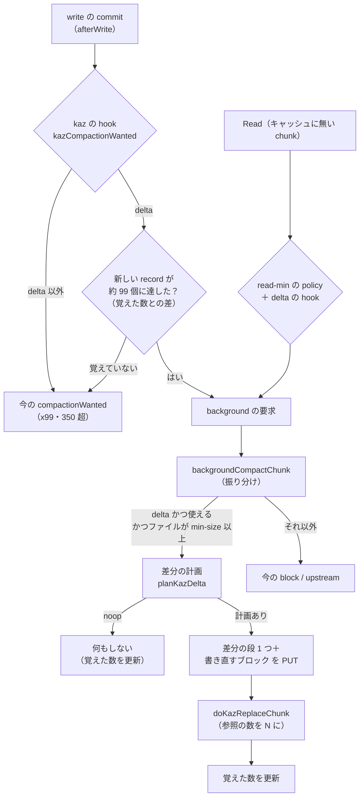

# 差分 slice 方式の compaction（kaz delta compaction）設計

日付: 2026-10-20。状態: 実装済み（2026-10-20 ユーザー承認の設計、本体 `feat/kaz-delta-compaction` c5c5658b..67c5c96d の 13 commit、push・merge なし、実機は未計測）。実装で決めたこと: Go の Config の gap は 0 が既定 16 KiB・−1 が「つながない」（CLI の 0 は −1）、計画が New ≥ 99 のまま諦めたときの基準の数は len(ss)、隠れの割合による全体の書き直しの event は `delta_hidden_full`、丸ごと取る規則は「キャッシュに入れる読み込みで、compaction の読み込みでないとき」だけ、畳み込みの候補には id 0 の record も数える。本体の作業ブランチは `feat/kaz-delta-compaction`（起点 `1.4.1-improve-kaz` c5c5658b。kaz-2q は merge 済み）。

[事実] は観測またはソースで確認したこと、[推論] は推定、[未確認] は確かめていないこと、**[判断]** はこの会話で agent が決めたこと（ユーザーが読んで直せるように印を付ける）。

根拠:

- [引き継ぎ](../../inspection/delta_slice/2026-10-20/handoff-ja.md)、[実現性の調査](../../inspection/delta_slice/2026-10-20/feasibility-ja.md)（file:line つき。B1〜B10 の番号はこの報告のもの）、[最初の見積もり](../../inspection/delta_slice/2026-10-20/estimate-ja.md)
- 段分け・部分畳み込みの模擬: `docs/inspection/delta_slice/2026-10-20/delta_sim2.py`、`sim2-tier-partial.txt`、`delta_sim2_gets.py`、`sim2-gets.txt`（入力の `writes.tsv` の SHA-256 の先頭は `63bd8f62cf2c3edf`、12:29〜15:28 の 178.8 分、chunk 6 個）
- 前の設計: [kaz block compaction](2026-10-14-kaz-block-compaction-design.md)

## 1. 目的

VM のディスクイメージのような巨大なファイルで、**少し書いただけで大量の PUT が出る状態をなくす**。

[事実] 今の block モードは、小さい書き込みが 1 つでも触れた 4 MiB のブロックを丸ごと書き直す。ゲストの 4〜8 KiB の書き込みが chunk のあちこちに届くため、chunk 1920 では約 2 分ごとに約 11 ブロック（44 MiB）を書き直していた。夜間は staging 5.0 GiB に対し、compaction の出力が 32.7 GiB（約 10 倍）だった。

差分方式では、元の 4 MiB のブロックを書き直さない。変更されたデータだけを 1 つの小さい slice（差分の「段」）に詰めて PUT し、chunk の record（`pos, id, size, off, len`）で同じ slice の別々の部分を指して読み分ける。

## 2. 成功の基準と、失敗とみなすこと

ユーザーの言葉:

- 「とにかく少し書いただけで大量の PUT が生成されるのが抑制されればよい」
- 「読み込みの遅さ（CPU 負荷）・Redis 負荷は微増程度なら受け入れる」

基準:

- **compaction の PUT の量が大きく減る。** 模擬の見込みは、chunk 1920 で今の方式の実績 5,112 MiB に対し約 200〜300 MiB、6 chunk の合計で 6,203 MiB に対し約 390〜610 MiB（§4）。
- **1 回の compaction の最大の PUT が、block モードより小さい。** 模擬では 52 MiB に対し 9〜16 MiB。
- 読み込みの GET と Redis の読み込みの増加は、§4 の見込みの範囲内（差分のある場所で GET が平均 1 回から 2.4〜2.8 回、record の数が 4〜6 倍）。
- 参照の無い object も、参照の不足も生まない（gc の leaked、データ消失がない）。

失敗とみなすこと（技術的に動いても失敗）:

- データの消失、古いデータや 0 が見えること（正しさは何よりも優先する）。
- アップロードを遅らせて PUT を減らす形（ユーザーは好まない。ログをすぐ見たい、他の client からすぐ見えてほしい）。
- 差分方式が合わない I/O パターンで、block モードより PUT が増えること（§5.4 の保証）。
- 読み込みが目に見えて遅くなること。
- 改造していない JuiceFS と同じ volume を使えなくなること。

## 3. 条件（ユーザーの方針と、守るもの）

- **upstream の変更に強いコード。** 判断は kaz のファイル（`*_kaz.go`）にまとめる。upstream 由来のファイルは hook の呼び出し程度にとどめる。
- **3 つのエンジンの parity。** Redis／SQL／TKV の置き換えの実装は、同じ意味で同じテストを通す。ただし TKV では差分方式を使わない（§5.9）。
- **改造していない JuiceFS との互換。** メタデータの形式（record の 24 バイト、参照数のキー）は変えない。新しい種類の key は作らない。
- **今の方式は捨てない。** `--kaz-compaction-mode` に `delta` を足す。既定は今のまま（upstream）。block を選んでいる mount の動きも変えない。
- fsync、書き込み順序、read-after-write を弱めない。実際の保存の失敗、容量不足、quota のエラーを隠さない。
- **アップロードを遅らせない。** compaction の起動の頻度は今と同じ程度（新しい record 約 99 個ごと）に保つ。[事実] compaction は writeback の staging にあるアップロード待ちの小さい slice を片付けて、その PUT を省いている（`Retire`）。block の設計（2026-10-14）で、この効果が PUT の総数を大きく左右すると分かっている。差分方式も同じ小さい record を外すので、片付けの効果は保たれる。
- ゲスト側の発生源の特定や設定の変更は、この設計の対象外。
- 本体の commit と文書の commit は、ユーザーが別々に行う。agent は明示の依頼なしに add／commit／push しない。

## 4. 効果の見積もり（模擬、[推論]）

`delta_sim2.py` で、`writes.tsv` の書き込みを時刻順に適用した。新しい record 85 個ごとに compaction する。隙間は 16 KiB までつなぐ。

| 案 | chunk 1920 の PUT | 6 chunk の PUT | 1 回の最大 PUT | record 最大／平均 | 段の最大 |
|---|---:|---:|---:|---:|---:|
| 今の方式の実績 | 5,112 MiB | 6,203 MiB | 約 44 MiB | — | — |
| 差分全体を毎回送り直し、まとめて畳み込む（最初の見積もり） | 645 MiB | 1,017 MiB | 52 MiB | 320／228 | 1 |
| 4 段・ブロック単位で畳み込む・上限 300 | 299 MiB | 593 MiB | 9 MiB | 384／281 | 4 |
| 8 段・ブロック単位で畳み込む・上限 500（既定の案） | 198 MiB | 386 MiB | 9 MiB | 581／387 | 8 |

読み込み（`delta_sim2_gets.py`。書き込みのあった場所を 64 KiB 読むとき、重なる差分の段の数）:

| | 4 段・上限 300 | 8 段・上限 500 |
|---|---|---|
| 平均 | 1.4 | 1.8 |
| 分布 | 1 段 66%、2 段 28%、3〜4 段 6% | 1 段 45%、2 段 36%、3 段 14%、4 段以上 5% |

- 1 回の読み込みの GET は「元のブロック 1 つ＋読む範囲にデータを持つ段」。段の上限と record の上限は瞬間の最大で、ふだんの量は平均の方である。
- record の数は、Redis の読み込み（キャッシュに無い chunk を読むたびの LRANGE と `buildSlice`）に効く。今の block モード（推定 平均 60 前後）の 4〜6 倍になる。
- 模擬で単純化していること [未確認]:
  - 段のまとめ直しは「全部を 1 段に」で数えた。
  - 「差分がブロックの半分以上なら書き直す」規則（§5.4）は入れていない。
  - 対象は 3 時間・6 chunk だけで、夜間の長い時間では確かめていない。
  - PUT は圧縮前の論理量。

## 5. 設計

### 5.1 全体の流れ

### 5.2 record の分類

[事実] メタデータには「これは差分」という印が無い。そのため計画の関数は、毎回 chunk の record そのものから分類する。再起動しても、別の client が compaction した後でも、同じ規則で分類できる。

- **id 0 の record（truncate、fallocate の穴あけ、block の mask）:** [事実] `marshalSlice(pos, 0, 0, 0, l)` で、size=0。差分にも新しい record にも入れず、base と同じく残す。外すのは、完全に隠れたときと、書き直すブロックの中だけにあるときだけ。
  - **[判断]** 差分に入れると、見え方の 0 を段の slice に 0 のバイトとして PUT することになる。さらに「差分がブロックの半分以上」の判定で、ブロックの書き直しまで誘発してしまう。id 0 の record は object を持たず、残しても PUT は増えない。
  - ゲストの discard が多いと id 0 の record が溜まる。これは record の上限による畳み込み（§5.4 の 5）で片付ける。
- **差分の record:** id > 0 で、同じ slice id を chunk の中の 2 つ以上の record が指す record。または `off != 0`、`len != size` の record。
- **新しい record:** id > 0 で、差分の record ではなく、block の `small`（ブロックより短く、ブロックの範囲をちょうど埋めていない、`compaction_block_plan_kaz.go` の `small`）である record。
- **base の record:** 上のどれでもない record（ブロックの形の record、ブロック以上の大きい record）。

誤分類しても正しさには影響しない。新しい段は、外す record が外す前に見えていた範囲を、外す前の見え方からコピーして作る（§5.5）。そのため、どの record をどの組に入れても、見え方は変わらない。誤分類で変わるのは費用だけである。

- record 1 つだけの段（`off=0, len=size`）は新しい record に見える。次の段に取り込まれ、小さい量を写し直すだけで済む。
- CopyFileRange が作った同じ id の record は、差分として扱われる。次のまとめ直しで取り込まれるだけで済む。

段の順番は、chunk の中で各 id の record が最初に出てくる位置の順とする。段の数は、差分の record が指す異なる id の数とする。

### 5.3 起動の条件（hook）

[事実] commit の後の起動は `base.go` の `afterWrite` が `compactionWanted(prev, now)` で判定している。x99 を通過したとき、または 350 を超えたら毎回 true。2,500 以上なら upstream の chunk 全体の書き直しを同期で行う。`compactionWanted` は kaz が upstream の 1 行（v1.4.1 の base.go:2176）を関数に切り出したもの。

差分方式では record の総数が常に多い（平均 280〜390）。総数のまま判定すると、350 を超えて書き込みのたびに起動してしまう。

- `afterWrite` の `compactionWanted(prevSlices, ph.numSlices)` を、kaz の `m.kazCompactionWanted(inode, indx, prevSlices, ph.numSlices)` に替える（priority の hint の count も合わせて渡す）。`base.go` の変更は `afterWrite` の数行。
  - delta モードでないときは、今の `compactionWanted` をそのまま返す。
  - delta モードでは、chunk ごとに「この client が最後にこの chunk を計画したときの、新しい record 以外の record の数（基準の数）」をメモリに覚えておく。`now − 基準の数` が `kazDeltaTrigger`（99、定数）以上になったら true を返す。基準の数を覚えていない場合や、`now` が基準の数より小さい場合は、今の `compactionWanted` に任せる。
  - この差には、新しい record 以外の書き込み（ブロックの形の書き込み、4 MiB 以上の書き込み）も入る。起動した後、計画の関数は、それらが base を完全に隠していれば外す（§5.4 の 1）。
  - 2,500 以上の同期の書き直しは安全網として残す。[事実] `afterWrite` の同期の分岐は `if compactionWanted(...)` の内側にある（base.go:2263-2271）。そのため hook は、delta モードでも `now >= maxSlices` なら必ず true を返す。
  - priority scheduler の hint の count（record の数で優先度を決める、`compaction_scheduler.go` の `compactionPriority`）には、delta モードで基準の数を覚えているときは `now − 基準の数` を渡す。
    - **[判断]** 差分の chunk は record の総数が常に多い（300〜580）。総数を渡すと、いつも上の優先度に入り、普通のファイルより先に処理されてしまう。
    - 渡し方（hook が count も返す、など）は計画で決める。`base.go` の変更は `afterWrite` の数行に収める。
- Read の要求も同じ考えで抑える。`requestCompactionFromRead`（kaz のファイル）で、delta モードかつ基準の数を覚えているときは、`count − 基準の数 < kazDeltaTrigger` なら要求を捨てる。覚えていないときは今の read-min の policy に任せる。`base.go` の Read は変えない。
- 基準の数は、差分の計画の関数が chunk を読んだときに更新する。
  - noop のとき: 読んだ record の総数から、新しい record の数を引いた数。
  - commit が成功したとき: 置き換えた後の record の数（kept＋outs）。commit の時点で後ろに来ていた record は、新しいものとして残す。
  - commit が EINVAL などで失敗したとき: 更新しない。次の書き込みでまた起動する。
- 覚える表の大きさには上限を設ける。
  - **[判断]** 上限は 65,536 個。あふれたら古いものから捨てる（捨てられても、今の条件に戻るだけ）。
  - ファイルの削除や truncate の後に古い値が残っても、`now` が基準の数より小さくなれば捨てる。正しさには影響しない。
- ~~**[判断]** 起動の数（99）はノブにしない。~~ 2026-10-21 訂正（ユーザー依頼）: `--kaz-compaction-delta-trigger` で変えられるようにした。早めればアップロード前の片付けが増え PUT の回数が減る可能性、遅らせれば compaction とメタデータの読み込みが減る（どちらも未検証）。

### 5.4 差分の計画（`planKazDelta`）

入力は chunk の record（最大 `maxCompactSlices`）、ブロックの大きさ、ノブ。出力は今の `kazBlockPlan` に「差分の段」を足した計画である。kept（元の順のまま）の上に、outs（新しい record）を置く。

1. **noop:** 次の 4 つが全部成り立つなら、nil を返す。（background の要求には、起動の後に他の client が先に片付けた場合なども来る。）
   - 新しい record の数が `kazDeltaTrigger` 未満
   - 完全に隠れた id > 0 の record が無い
   - record の総数が上限以下
   - 段の数が上限以下

   完全に隠れた record だけを外す計画は PUT が 0 で、メタデータの置き換えだけになる。[事実] block モードでは、隠れた大きい record も約 99 個ごとの compaction で外れていた。
2. **外す record を決める:**
   - 完全に隠れた record（今の `kazFullyHidden`）
   - 新しい record の全部
   - 段が上限（`delta-tiers`）を超える場合は、差分の record の全部（まとめ直し）
3. **ブロックごとの選択:** 外す record が触れたブロックごとに、次のどれかなら、そのブロックを **書き直す**（今の block と同じく、ブロックの範囲を見え方からコピーした 1 slice・1 record）。それ以外は **差分に入れる**。
   - そのブロックの、見えている差分のバイト（外す record の見えている範囲の和集合＋残す差分の record の見えている範囲を、隙間 `delta-gap` でつないだもの）が、ブロックの半分以上。
   - そのブロックに、base の record（id > 0）が 1 つも重ならない（追記などで下に元のデータが無い）。
   - 書き直すブロックの中だけにある record（base、差分、新しい record のどれでも）は外す。ブロックをまたぐ record は、そのすべてのブロックを書き直す場合だけ外し、それ以外は残す。
4. **新しい段:** 外す record が見えていた範囲のうち、書き直すブロックの外の部分を、隙間 `delta-gap` 以下でつなぐ。つないだ隙間は、見え方（base の内容）ごと差分にコピーする。それを位置順に連結して 1 つの slice とし、範囲ごとに 1 record（`marshalSlice(pos, id, size, off, len)`、`off` は前の範囲の長さの累積）を作る。範囲は書き直すブロックの境目で切り、書き直すブロックの中には入れない。
5. **record の上限:** 置き換えた後の record の数が上限（`delta-max-records`）を超える場合は、差分の record（ブロックの中だけにあるもの）が一番多いブロックから 1 つずつ書き直しに加える。上限より 50 少なくなるまで続け、手順 3〜4 をやり直す。
   - **[判断]** 50 は定数。
   - ブロックの数を使い切っても下回らない場合は、今の block の全体の書き直し（`full`）にする。
6. **保証:** 1 回の compaction の PUT のバイト数は、「同じ record のうち `small` の record（差分の record と新しい record）が触れたブロックを全部書き直したときのバイト数」を超えない。これは block の計画の部分の書き直しの量で、全体の書き直しに倒れる規則（`kept＋touched > 17`、hidden-ratio）は比べる側に入れない。比べる側の方が小さいので、厳しい比較になる。
   - [推論] 手順 3 で、差分に入れるのは差分がブロックの半分未満のブロックだけである。block の計画は差分の record も `small` として外し、触れたブロックを全部書き直す。
   - 計画の関数の中で両方のバイト数を計算し、超える場合は「触れたブロックを全部書き直す」計画を使う（`assert` ではなく選択とする）。この場合は delta モードの record の上限で判定し、17 による全体の書き直しには倒さない。
   - これは 1 回ごとの保証である。I/O パターンごとの合計が block モード以下であることは、§6 の 2 で確かめる。合計が block モードを上回るパターンが見つかったら、設計を見直す（ユーザーと相談する）。
7. **隠れたデータの割合:** 今の block の `hidden-ratio` の判定（残す record のデータが新しいものに隠れる割合が 0.5 を超えたら全体を書き直す）は、**base の record だけ**で数える。差分の段同士の隠れ合いは、段の上限によるまとめ直しで片付くので、数えない。
   - **[判断]** 差分を含めて数えると、段が重なるだけで全体の書き直しに倒れ、方式の意味がなくなるため。
8. block モードの `kept＋書き直すブロック > block-max-slices（17）` の規則は、delta モードでは使わない。代わりに `delta-max-records` を使う。

正しさの不変条件（テストで確かめる）:

- **(I1)** 置き換えの前後で、`buildSlice` の見え方のバイト列が同じ。
- **(I2)** 外す record が外す前に見えていた範囲は、全部 outs（書き直すブロック、または新しい段の record）で覆われる。
- **(I3)** outs は kept の上に置く。compaction 中に来た書き込みは、outs のさらに上に残る（今の置き換えと同じ。read-after-write が保たれる）。
- **(I4)** 新しい段の slice の参照の数は、その slice を指す record の数と同じ。

### 5.5 object の書き込み

- [事実] 今の `writeKazBlocks` は、出力ごとに `NewSlice` で id を取り、`CompactChunk` のメッセージ（`vfs.Compact`）に piece の列を渡す。`vfs.Compact` は piece を前から連結して 1 つの slice を書き、PUT が終わってから返る（`SetWriteback(false)`）。
- 新しい段は「範囲ごとの piece（`kazClipPieces` で見え方から切り出したもの）を位置順に連結した列」を 1 つの `CompactChunk` で書く。`vfs.Compact` とその kaz-2q のキャッシュ配置（`kazCompactionSources`）は変えずに使える。
- 新しい段の大きさは、chunk の大きさ（64 MiB）を超えない。まとめ直しで 4 MiB を超えたら、`vfs.Compact` が 4 MiB ごとの block に分けて書く（1 つの slice のまま）。
- 書き直すブロックは、今の `writeKazBlocks` と同じく 1 ブロック 1 slice で書く。段と書き直すブロックは、今と同じ同時数（16）で並行して書く。

### 5.6 commit と参照の数（B1、B3、B4、B10）

- `kazChunkReplacer.doKazReplaceChunk` に、作った slice ごとの参照の数を渡せるようにする。
  - **[判断]** 引数を `created []Slice` から、`Refs int` を持つ kaz の型の列（例 `[]kazCreated{Slice, Refs}`）に替える。interface は kaz の中だけのものなので、upstream の interface には触れない。block モードの呼び出しは `Refs: 1` を渡す。
- 同じトランザクションの中で、次の値にする。
  - Redis: `HSet sliceRef k{id}_{size} = Refs−1`
  - SQL: `sliceRef{id, size, Refs}` を insert
  - TKV: `packCounter(Refs−1)` を set
- 成功の後の `cleanupZeroRef`（値 0 の key を消して「無い＝1」に戻す）は、値が 0 のときだけ意味がある。Refs > 1 のときは呼んでも消さない（今の `cleanupZeroRef` は値 0 のときだけ消すことを、計画の段階でソースで確かめる）。
- 「commit できたか分からない」エラーの確かめ方（`created[0]` の参照の key の有無）は今のまま使える。Refs によらず、key を必ず作るため。
- EINVAL（chunk の先頭が変わっていた）のときは、今と同じく作った slice ごとに 1 回だけ減らして死なせる。commit されていないので参照の key は無く、「無い＝1」から −1 になる。
- 外す record の参照は、今と同じく **record ごとに 1 つずつ** 減らす（B3 を避ける）。参照の変更は「外す record」と「作った slice の Refs」の 2 つの経路だけにする（B4 を避ける）。
- 削除の通知（`enqueueCompactionDelete`）は、id ごとにまとめてから出す（B10。SQL と TKV は commit の後に record ごとに参照を読み直すので、同じ id が重なりうる）。
- trash（trash-days > 0）のときの delayed は、今と同じく外す record ごとに `(id, size)` を書く。

### 5.7 読み込み（小さい object は丸ごと取る）

- [事実] `pkg/chunk/cached_store.go` の `rSlice.ReadAt` は、キャッシュが無く、object の途中から 1/4 以下を読むとき、object 全体を取らずに range GET をする（156 行の条件）。差分の object は小さいので、ここに当てはまりやすい。小さく読むたびに、別々の range GET になるおそれがある。
- delta モードのときは、大きさが `kazWholeReadMax`（**[判断]** 1 MiB、定数）以下の object には range GET を使わず、object 全体を取ってキャッシュに入れる。
  - `chunk.Config` に kaz の項目を 1 つ足す。mount で delta モードのときに設定する。
  - `cached_store.go` の条件に kaz の関数を 1 つ挟む。upstream 由来のファイルの変更はこの 1 か所。
  - 通常の書き込みの小さい slice にも同じように効くが、Google Drive のように 1 回の GET の待ちが大きい backend では、丸ごと取る方が得と見込む [推論]。
- [事実] compaction の出力は、元の block がキャッシュにあれば kaz-2q の配置でキャッシュに入る（`pkg/vfs/compact_cache_kaz.go`）。差分は最近書いた場所の集まりなので、作った直後はキャッシュにある見込み [推論]。

### 5.8 強制の compaction（`juicefs compact`、`gc --compact`）

今の block モードと同じく `planKazBlockCompactionForced` を使う。差分の record は `small` として外れ、触れたブロックを全部書き直す。chunk はブロックの形・隠れたデータ 0 に戻る。`forcedCompactChunk` の振り分けで、delta も block と同じ経路に入れる。

### 5.9 使えないとき（自動で block に戻す）

次のどれかのときは、delta を選んでいても、その mount の background compaction は block モードで行う。mount の開始時に 1 回 WARN を出し、metrics に `fallback_block` を数える。

- **TKV のエンジン**（TiKV、etcd、BadgerDB、FoundationDB）。
  - [事実] TKV の単一ファイルの clone（`kvMeta.doCloneEntry`、upstream v1.4.1 にもある）は、同じ slice を複数の record が指すと、参照を 1 しか増やさない（B2）。改造していない client が clone しても起きるため、kaz の側だけでは防げない。
  - 置き換えの実装は TKV にも Refs を入れて、parity のテストを通しておく（将来 B2 を直したら使えるように）。
  - **[判断]** 判定は `kazChunkReplacer` に足す小さい interface（例 `kazDeltaCapable`）で行う。Redis と SQL だけが実装する。`tkv.go` の B2 の修正は、この設計の範囲外（別の課題）。
- 1 回の compaction で読める record（`kazBlockCompactLimit`）が `delta-max-records ＋ kazDeltaTrigger ＋ 50` より小さいエンジン。
- block モード自体が使えないとき（ブロックの大きさなど、今の `kazBlockReplacer` の条件）。この場合は今と同じく upstream に戻る。
- ファイルの長さが `delta-min-file-size` より小さいとき（chunk ごとに、その compaction の時点で判定する）。
  - [事実] 今の `runKazBlockCompaction` が `GetAttr` を呼ぶのは、tier が分からないとき（Read、強制）だけで、しかも計画の後である（compaction_block_kaz.go:176-182）。
  - **[判断]** `delta-min-file-size` が 0 より大きいときだけ、計画の前に `GetAttr` を 1 回呼んで長さを得る。0 なら属性を余計に取らない。compaction 1 回につき Redis の読み込みが 1 回増えるだけなので、scheduler の hint の型は変えない。

### 5.10 ノブ（mount のオプション）

| オプション | 意味 | 既定値 | 範囲 |
|---|---|---|---|
| `--kaz-compaction-mode` | `delta` を足す | upstream（今のまま） | upstream / block / delta |
| `--kaz-compaction-delta-tiers` | 差分の段の上限。超えたら、全部の差分を 1 段にまとめ直す | 8 | 1〜16。1 なら毎回差分全体を送り直す |
| `--kaz-compaction-delta-max-records` | chunk の record の上限。超えたらブロック単位で畳み込む | 500 | 50〜800 |
| `--kaz-compaction-delta-gap` | この幅以下の隙間は、元のデータごと差分に入れて record を減らす | 16 KiB | 0〜1 MiB |
| `--kaz-compaction-delta-min-file-size` | この長さ未満のファイルの chunk は block モードにする | 0（絞らない） | 0 以上 |
| `--kaz-compaction-delta-trigger` | 前の計画の後に来た record がこの数になったら compaction する（2026-10-21 追加、ユーザー依頼） | 99 | 10〜400（max-records＋trigger＋50 ≤ 1000） |
| `--kaz-compaction-delta-block-ratio` | ブロックの中の差分がブロックの大きさのこの割合に達したら、そのブロックを書き直す（2026-10-21 追加、ユーザー依頼。既定は従来の「半分」と同じ） | 0.5 | 0 < r ≤ 1 |

- 既定値は、ユーザーの目的（PUT を一番減らす）に合わせて 8 段・上限 500 とした（ユーザー了承）。
- 本番の最初の投入では `--kaz-compaction-delta-min-file-size 1G` を指定して試す案（ユーザー了承）。
- ノブはボリュームに保存しない。計画は毎回 record から立てるので、mount ごとに値が違っても、途中で変えても、正しさには影響しない。
- `delta-max-records` の上限 800 は、1 回の compaction が読む record（`maxCompactSlices` = 1000）から、新しい record（99）と余裕を引いた値である。
- block のノブ（`hidden-ratio`）は、delta でも base の record に使う（§5.4 の 7）。
- 検証は今の `ValidateKazBlockCompaction` と同じ所で行う。範囲外は mount の開始時に止める（cmd）か、Go の呼び出しでは既定値に戻して WARN を出す（`SelfCheck`）。今の block のノブと同じ扱いとする。

### 5.11 観測（metrics とログ）

- `kaz_compaction_block_events_total{event}` に次を足す。
  - `delta_noop`、`delta_tier`（新しい段を作った）、`delta_merge`（まとめ直した）、`delta_fold`（record の上限による畳み込み）、`delta_block_fallback`（§5.4 の 6 で block の計画を選んだ）、`fallback_block`（§5.9）
- `kaz_compaction_block_amount_total{kind}` に次を足す。
  - `delta_bytes`（段の PUT のバイト）、`delta_records`（段の record の数）、`delta_fold_blocks`
  - 2026-10-21 追加: 書き直したブロックの理由 `delta_blocks_whole`／`delta_blocks_fallback`／`delta_fold_blocks`／`delta_blocks_nobase`／`delta_blocks_ratio`（1 ブロックに 1 つ、合計は blocks_written）、まとめ直しの段のバイト `delta_merge_bytes`
- ログは今の block と同じ形にする。`compaction block … mode=delta-tier|delta-merge|delta-fold …` の DEBUG と、slow compaction の `mode=delta`。段の数、差分の record の数、段のバイト、書き直したブロックの数を出す。

### 5.12 改造していない client との互換（[事実] 実現性の調査 §2）

- 改造していない JuiceFS（upstream v1.4.1）でも、読み込み、書き込み、upstream の compaction、削除、gc、JSON の dump/load は正しく動く。
- ただし、record が 5 個以上ある chunk を読むと compaction を要求し、chunk 全体を書き直す（費用だけの問題）。
- また、record が 350 を超えている差分の chunk に書くと、書き込みのたびに compaction を要求する（upstream v1.4.1 の Write の条件）。1 回書き直せば record が減るので、自然に収まる（費用だけの問題）。
- delta を知らない kaz の client（block モード）は、差分の record を `small` として外し、触れたブロックを全部書き直す。これも正しく、費用だけの問題。
- 既存の不具合で、差分方式で頻度が上がるもの:
  - TKV の clone（B2）: TKV では delta を使わないことで避ける。
  - upstream v1.4.1 の Redis CopyFileRange と compaction の競合（B6）: kaz では修正済み。改造していない client で `cp --reflink` などを compaction と同時にしない運用で避ける。
- これらは製品の文書（ヘルプ）と、調査の文書に書く。

## 6. テスト

完了の条件は、すべてのテストが通ること。Redis が要るテストは一時的な Redis（127.0.0.1:6379、終了後に停止）で `make test.meta.non-core` の該当部分を動かす。core は `make test.meta.core`。kaz の変更は `-race` で通す。

1. **計画の関数の単体テスト**（エンジン不要）
   - (I1)(I2) を、乱数で作った書き込みの列で確かめる。小さい書き込み、重なり、truncate の id 0、CopyFileRange の形の record を混ぜる。compaction を何回も繰り返し、ノブも乱数にする。
   - 同じ列に block の計画を当て、PUT のバイトが超えないこと（§5.4 の 6）を確かめる。
   - 分類（§5.2）、段の数、まとめ直し、record の上限による畳み込み、ブロックの半分の規則、元のデータが無いブロックの規則、ブロックをまたぐ record。
2. **I/O パターンごとの比較**（計画の関数を繰り返し当てる模擬。エンジン不要）
   - ばらばらの小さい上書き（VM の形）、1 ブロックの密な書き直し、末尾への追記、ブロック以上の大きい書き込み、小さいファイル。
   - 各パターンで、PUT の合計が block モード以下であること。VM の形では大きく減ること。
3. **置き換えの 3 エンジンの共有テスト**（今の `compaction_block_replace_kaz_test.go` の形。Redis／SQL（SQLite）／TKV（memkv、Badger））
   - (I4): N 個の record が 1 つの slice を指す置き換えの後、record を 1 つ外しても object が消えない。全部外すと消える。
   - EINVAL のときに差分の slice が消える。trash を有効にしたとき。削除の通知が id で 1 回。
4. **chunk の操作との組み合わせ**（3 エンジン）
   - 差分のある chunk を、ファイルの削除、truncate、fallocate、upstream の `compactChunk`、block の計画、強制の compaction にかける。データと参照の数（最後に全部が 0 になり、object が消える）が正しいこと。
   - clone、CopyFileRange（Redis／SQL）の後に片方を消しても、もう一方が読めること。
   - JSON の dump/load の後の参照の数が正しいこと。
5. **起動の hook**
   - 基準の数を覚えているとき、覚えていないとき、他の client が compaction した後、2,500 の安全網。
   - Read の要求の抑え方。
6. **vfs のデータのテスト**（今の block の vfs テストと同じ形）
   - 実際に書いた内容が、差分の compaction を何回繰り返しても読めること。
   - 小さい object を丸ごと取る規則（§5.7）で、データが正しく、2 回目はキャッシュから読むこと。
7. **cmd**: ノブの解析と範囲の検証（今の `kaz_compaction_policy_flag_test.go` の形）。

## 7. 範囲の外（別の課題）

- TKV の clone の参照の不足（B2）の修正（`tkv.go`、upstream にも報告する価値がある）。
- 段のまとめ直しの工夫（全部を 1 段にではなく、小さい段同士だけをまとめるなど）。
- 実機での計測（本番の VM で、夜間を含めて PUT・読み込み・Redis の負荷を測る）。ビルドと本番への投入はユーザーが判断する。
- 参照の数を検査・修復するコマンド。

## 8. 計画を立てる人に任せること

- 関数・型・ファイルの分け方（kaz のファイルの中で）。今の block のファイルに足すか、`compaction_delta_*_kaz.go` を作るか。
- 基準の数の表の実装（LRU の形、ロック）。
- metrics の名前の細部と、ログの項目の並び。
- テストの乱数の種と回数。ただし CI で現実的な時間に収める。
