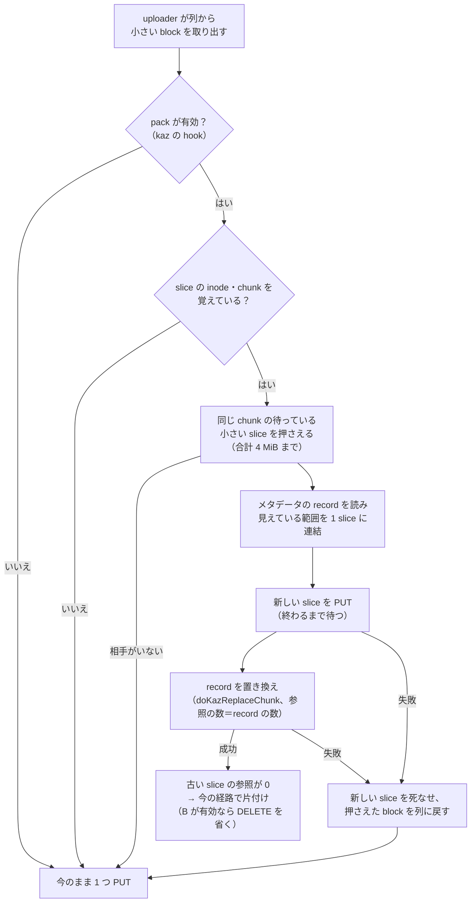

# staging のアップロード待ちで小さい slice をまとめる（kaz staging pack）設計

日付: 2026-10-27。状態: 設計（2026-10-27 ユーザー承認）。本体は未変更。builder check（別の reviewer がソースと突き合わせた）の指摘 5 点を反映済み（§5.1 の trash、§5.3 の状態、§5.4 の 6、§6.1〜6.2、§7）。

[事実] は観測またはソースで確認したこと、[推論] は推定、[未確認] は確かめていないこと、**[判断]** はこの会話で agent が決めたこと（ユーザーが読んで直せるように印を付ける）。ソースの行番号は本体 `1.4.2-improve-kaz`（HEAD `d246b0f7`）のもの。

根拠: [実現性の調査と見積もり](../../inspection/staging_pack/2026-10-27/feasibility-ja.md)（模擬 `pack_sim.py` と出力 `pack_sim.txt` を同じ場所に置いた）、[差分 slice 方式の設計](2026-10-20-kaz-delta-compaction-design.md)、[流し直しの比較](../../inspection/delta_slice/2026-10-21-suite/README-ja.md)。

## 1. 目的

object storage への **API コールの回数を減らす**。対象は、ゲストの 4〜8 KiB の書き込みが writeback の staging から slice ごとに 1 回ずつ送られる PUT と、アップロード前に片付けた slice に送られる DELETE。

ユーザーの言葉:

- 「単純に put の API コール回数を減らしたい（どこの object storage バックエンドでも効く、API コール課金、rate limit などで）」
- 「put が多いと他が遅くなる可能性がある（gdrive、他でも）」
- 「特に gdrive は drive api が遅いのでまとめる効果が高そう」
- DELETE を省く案も入れる。「delete は漏れないようにしてください（object storage 側の容量を無駄に消費したくない）」
- 「upstream の更新時に取り込みやすい形を意識してください」

## 2. 成功の基準と、失敗とみなすこと

基準:

- jfsreplay suite（`tests/juicefs/`、2026-10-21 の記録）で、本番と同じ設定（delta、trigger 30）に対して PUT の回数が減る。模擬の見込みは約 −28%（[推論]、§9）。
- 同じ試験で DELETE の回数が大きく減る（片付けた slice の数とほぼ同じ回数を省けると見込む [推論]）。
- 参照の無い object を残さない（`juicefs gc` の leaked が増えない）。参照の不足も生まない。
- 待ち行列が詰まっていないときは、今と同じ動き（PUT が増えない、遅くならない）。

失敗とみなすこと（技術的に動いても失敗）:

- データの消失、古いデータや 0 が見えること。
- アップロードを遅らせて回数を減らす形（ユーザーは upload-delay を好まない）。
- DELETE を省いたせいで object storage に object が残ること。
- 無改良の JuiceFS と同じ volume を使えなくなること。
- upstream の版に追従するときの衝突が大きく増えること。

## 3. 条件（守るもの）

- fsync、書き込み順序、read-after-write を弱めない。fsync が返る条件（staging への書き込みとメタデータの commit）には触れない。まとめるのは、その後の非同期のアップロードだけ。
- 実際の保存の失敗、容量不足、quota のエラーを隠さない。
- メタデータの形式は変えない。新しい種類の key は作らない。record は既存の 24 バイトの形（`pos, id, size, off, len`）だけを使う。
- バックエンドごとの分岐を入れない。判断に使うのは「列で待っている同じ chunk の小さい slice」だけ。1 回の PUT の大きさは block（4 MiB）以下で、今と同じ範囲。
- **upstream に追従しやすい形。** 判断と処理は kaz のファイル（`*_kaz.go`）に置く。upstream 由来のファイルの変更は、hook の呼び出しの数行にとどめ、変えた行の上に `// kaz:` の行コメントで目的を書く（AGENTS.md の例外の規則）。新しく足す関数・型には doc コメントを付ける。
- ゲスト側の発生源の特定や設定の変更は対象外。
- 本体の commit と文書の commit はユーザーが別々に行う。agent は明示の依頼なしに add／commit／push しない。

## 4. 全体の形

2 つの独立した機能を足す。どちらもフラグで有効にし、既定は無効（upstream と同じ動き）。

| 機能 | フラグ（**[判断]** 名前） | 既定 | 効くもの |
|---|---|---|---|
| A. まとめる（pack） | `--kaz-staging-pack` | false | staging の PUT の回数 |
| B. アップロードしていない object の DELETE を省く | `--kaz-skip-unuploaded-delete` | false | 片付けた slice の DELETE の回数 |

ユーザーの承認（2026-10-27）: 既定は無効、本番の mount スクリプトでユーザーが有効にする。

## 5. 機能 A: まとめる（pack）

### 5.1 いつまとめるか

- [事実] writeback で `--writeback-threshold-size` 未満の block は staging に書かれ、アップロードの枠が空いていればすぐ PUT され（`beginImmediateStaging`、`cached_store.go:462-478`）、空いていなければ `pendingKeys` と `pendingCh` に入る（`addDelayedStaging`、`cached_store.go:1142`）。`uploader` が取り出して `uploadStagingFile`（`cached_store.go:1085`）で PUT する。
- まとめるのは `uploadStagingFile` で取り出した block だけ。すぐ PUT する経路（枠が空いているとき）は変えない。待たせる仕組みは足さない。
- まとめる相手の条件（すべて満たすもの）:
  - 同じ inode・同じ chunk の slice。
  - slice の長さが block の大きさ未満（block が 1 つだけ）。
  - その block が `pendingKeys` にあり、PUT がまだ始まっていない（PUT の印が無く、`activeStaging` が 0。§5.3 の状態が「待ち」）。
    - [事実] 列（`pendingCh`）に入った item は、入る前に `uploading` が true になる（`cached_store.go:1160-1162`、scan も同じ `:1196`）。false に戻るのは `endStagingUpload` だけ。そのため `uploading` では「待ち」を見分けられない。§5.3 の別の状態を使う。
  - 表（§5.2）に載っている slice（再起動の後の scan で登録したものは inode・chunk が分からないので対象外）。
- まとめは、その時点の volume の `TrashDays` が 0 のときだけ行う（**[判断]**）。[事実] trash があると、kaz の置き換えは外した slice の参照を減らさずに trash に回す（`compaction_block_kaz.go:310-318`）。古い slice は trash の期間中片付かず、PUT されるので、まとめの PUT の分だけかえって増える。動いている間に format が変わることもあるので、まとめのたびに確かめる（諦めた理由に数える）。
- 取り出した block を含めて 2 つ以上の slice がそろったときだけまとめる。合計（見えている範囲の和）は block の大きさ（4 MiB）まで。超える分は次の機会に回す（今のままアップロードされるか、次に取り出されたときにまとめられる）。
- **[判断]** 時間や個数のしきい値は持たない。「待っている相手がいる」だけで判断する。待ち行列が詰まっていなければ相手がいないので、自然に何もしない。

### 5.2 slice → inode・chunk の対応

- [事実] chunk store（`pkg/chunk`）は slice の id しか知らない。inode と chunk の番号は vfs の writer が知っている（`commitSlices`、`writer_kaz.go:119`）。
- vfs の writer が commit に成功したとき（不確かなときも含めてよい。§5.4 で record から確かめるため）に、writeback で block 1 つの slice について `id → (inode, chunk の番号)` を kaz の表に覚える。表は chunk ごとに id の集合も持つ（相手を探すため）。
- 表から消すとき: その slice の片付け（Retire）、アップロードの完了、まとめの完了。大きさには上限を設け、あふれたら古いものから捨てる（捨てても今のままアップロードされるだけ）。上限の値は計画で決める。
- 再起動すると表は空になる。再起動の前の staging は今のまま 1 つずつアップロードする。

### 5.3 押さえる（claim）と item の状態

pending の item に、kaz の状態を 1 つ足す（`uploading` とは別。`pendingMutex` の中で読み書きする）。

| 状態 | 意味 | uploader が取り出したとき | 1 分ごとの scan |
|---|---|---|---|
| 待ち（既定） | 今と同じ | 今のまま PUT（PUT の印を付ける） | 今のまま |
| 押さえ中 | まとめの処理が持っている | PUT せずに捨てる（`uploading` を false に戻す） | 入れない |
| まとめ済み | 置き換えが成功し、参照が 0 になった。Retire を待つ | PUT せずに捨てる（`uploading` を false に戻す） | 入れない |

- **hook の位置:** uploader が列から取り出した直後、`beginStagingUpload`（`activeStaging++`）より前に置く（**[判断]**）。取り出した item（trigger）も、相手と同じく「押さえ中」にして、`activeStaging` には数えない。まとめの PUT と置き換えの間に Retire が来ても「アップロード中」で失敗しないため。
- **押さえ方:** `pendingMutex` の中で、`pendingKeys` にあり、状態が「待ち」、PUT の印が無く、`activeStaging` が 0 の item を「押さえ中」にする。列の中にいる item（`uploading` が true）も押さえられる。押さえ中の item は、uploader が後で取り出しても PUT しない。
- 押さえた item のデータは staging のファイルから読む（今の `uploadStagingFile` と同じ読み方、checksum の確認を含む）。読めなかった item は「待ち」に戻して外す。
- **終わったとき**（置き換えの結果の参照の数は §5.4 の 6）:
  - 置き換えで参照が 0 になった slice の item → 「まとめ済み」。staging と pending の片付けは、今の経路（compaction の GC の Retire）に任せる。まとめの処理が自分で消さない。
  - それ以外（参照が残った slice、置き換えに入らなかった slice、失敗したとき）→ 「待ち」に戻す。そのとき `uploading` が false（列の外）なら、`uploading` を true にして `pendingCh` へすぐ入れ直す（入らなければ false に戻して scan に任せる）。true（まだ列の中）なら入れ直さない（二重に入らない）。入れ直しを遅らせると、アップロードを遅らせたことになるため。
  - [推論] 参照が残る slice（clone や copy_file_range で別の record も指している）を「まとめ済み」にすると、永遠にアップロードされずデータが消える。そのため、参照の数の結果で分ける。
- 「まとめ済み」の item は、Retire の hint があふれたときなどは片付けが遅れる（durable marker の回収を待つ）。その間 PUT はしない。再起動すると状態は消え、scan が見つけて PUT し、後で DELETE される（無駄だが安全）。

### 5.4 メタデータの置き換え（pkg/meta、kaz のファイル）

- 新しい関数（例 `KazPackChunk(inode, indx, ids, data)`、名前は計画で決める）を kaz のファイルに足す。
- 手順:
  1. chunk の排他（`compacting` の表、`base.go:2846`）を取る。取れなければ諦める（待たない。uploader を止めないため）。
  2. chunk の record を読む。押さえた id の record のうち、見えている範囲（`buildSlice` の見え方）を集める。record に無い id（commit がまだ、または既に外れた）は外す。
  3. 見えている範囲を位置順に連結して 1 つの slice にする。範囲ごとに 1 record（`off` は前の範囲の長さの累積）。**隙間は埋めない**（元のデータを読まない）。完全に隠れた record は、データを持たずに外すだけ。
  4. 残った slice が 2 つ未満なら諦める。
  5. `NewSlice` で id を取り、連結したデータを PUT する（今の compaction と同じく `SetWriteback(false)`、PUT が終わってから次へ）。
  6. `doKazReplaceChunk` で、押さえた id の record を新しい record に置き換える。新しい slice の参照の数は record の数（`kazCreated{Refs: n}`）。古い slice は record ごとに 1 つ減らす。どの古い slice の参照が 0 になったかを、呼び出し元（chunk store）まで返す（今は Redis の `rs[i].Val()<0` などエンジンの中に閉じている。kaz のファイルの中で返り値を足す。Redis／SQL で同じ意味にする）。
  7. 失敗（EINVAL、不確か）のときの扱いは、今の delta compaction と同じ（作った slice を死なせる／参照の key の有無で確かめる）。
- 正しさの不変条件は、差分方式の I1〜I4 と同じ（置き換えの前後で見え方が同じ、外す record の見えていた範囲は全部新しい record で覆う、新しい record は残す record の上に置く、参照の数＝record の数）。見えている範囲だけを上に置くので、後から来た書き込みを隠さない。
- **[判断]** まとめは `--kaz-compaction-mode delta` のときだけ有効にする。それ以外のときは起動時に WARN を出して無効にする。理由: まとめた slice は差分の段と同じ形で、delta の計画がそれを段としてまとめ直す前提で作られている。試験の組み合わせも減らせる。差分方式と同じく TKV では使わない（`kazDeltaUsable`）。
- データの読み方（**[判断]**）: 連結に使うデータは、§5.3 で staging から読んだものを渡す。`vfs.Compact` の読み込み（キャッシュに無ければ GET）は使わない。アップロード前の object を GET すると見つからずに再試行が続くため。

### 5.5 compaction との関係

- [推論] まとめた slice は、delta の計画から見ると差分の段（同じ id を複数の record が指す）。段の上限（`--kaz-compaction-delta-tiers`、8）を早く超え、段のまとめ直し（1 回の PUT、バイトは差分の合計）が増える。compaction のバイトは少し増えると見込む（未見積もり）。suite で確かめる。
- record の数は変わらない（k 個の record が、同じ slice を指す k 個の record になる）。delta の起動の数え方（`kazCompactionWanted`）にも影響しない。
- compaction とまとめは同じ chunk の排他を使うので、同時には走らない。

### 5.6 upload-delay と組み合わせたとき

- [事実] `--upload-delay` が 0 より大きいと、すぐ PUT する経路を使わず、すべての block が待ち行列を通る（`cached_store.go:462`）。block は staging から delay 秒たった後に列に入る（`addDelayedStaging`、`scanDelayedStaging`）。
- まとめの相手の条件（§5.1）は delay を見ない。取り出した block が delay を過ぎていれば、同じ chunk のまだ delay 前の小さい block も一緒にまとめて送る（2026-10-27 ユーザーの確認済み）。後から来た block は delay より早くアップロードされるが、正しさには関係しない。
- [推論、模擬] trigger 30 で delay を足したときの PUT（[調査報告 §8](../../inspection/staging_pack/2026-10-27/feasibility-ja.md)）: delay 0 s の pack なし 5,290 → delay 60 s の pack 2,086（約 −61%）。delay を過ぎたものだけを取る形では 3,395 にとどまる。
- upload-delay を使うかどうかはユーザーが mount の設定で決める（既定 0 のまま。この設計では変えない）。

## 6. 機能 B: アップロードしていない object の DELETE を省く

### 6.1 省いてよい条件

- [事実] `rSlice.Remove`（`cached_store.go:191`）は `Retire` の後、block ごとに DELETE を必ず送る。
- 省くのは、片付ける block が次のすべてを満たすときだけ。
  1. その block の pending の item が、Retire の時点で `pendingKeys` にある。
  2. その item は **この process が staging して登録した**（`wSlice.upload` の経路）。再起動の後の scan で登録したものは省かない（前の process が PUT した後、staging を消す前に落ちたことがある）。
  3. その item について **PUT を一度も始めていない**。PUT を始めたら（すぐ PUT する経路、`uploadStagingFile`、再試行のどれでも）印を付け、印は二度と外さない。時間切れになった PUT が後で成功していることがあるため。
- それ以外（pending に無い、直接アップロードした、staging に失敗した、印がある）は、今どおり DELETE を送る。
- 印は pending の item に持たせ、`pendingMutex` の中で読み書きする。Retire が pending から外すのと、uploader が PUT を始めるのは、同じ mutex で順番が決まる（今の `beginStagingUpload` と `Retire` の関係）。押さえ（§5.3）は PUT ではないので印を付けない。
- 「この process が登録した」の印は、`wSlice.upload` の経路で item を新しく作ったときだけ付ける。起動時の scan（`disk_cache.go:171`、新しい書き込みと同時に走る）が先に作った item を使い回すときは、印を後から付けない（**[判断]**、安全側。DELETE を送るだけ）。

### 6.2 判断を DELETE の時点まで運ぶ

- [事実] 本番の `--compaction-gc-mode deferred` では、compaction で外れた slice は、まず GC の dispatcher が `Retire` を呼び（ローカルの片付け、`compaction_gc.go:100`）、その後で別に `DeleteSlice` → `rSlice.Remove` → もう一度 `Retire` → DELETE と進む。2 回目の `Retire` の時点では、pending の item はもう無い。
- そのため、`Retire` が pending から item を外すときに §6.1 の条件を満たした key を、メモリの集合（「アップロードしていない key」）に入れる。`rSlice.Remove` は DELETE の前にこの集合を見て、入っている key の DELETE を省き、集合から消す。
  - 集合に入れるのは、`Retire` が成功したとき（「アップロード中」で失敗したときは入れない）。
  - 集合の大きさには上限を設ける。あふれたら入れない（DELETE を送るだけ）。
  - 再起動、durable marker の回収（別の process のこともある）、hint のあふれで集合に無いときは、DELETE を送る（**[判断]**、安全側。省けないだけで漏れない）。
- compaction の GC を使わない経路（upstream の GC モード、`Abort` など）でも、`Retire` と `Remove` の順番は同じなので、同じ集合で扱える。

### 6.3 漏れないこと

- Retire が「アップロード中」で失敗したとき（`ErrSliceUploadInFlight`）は、今どおり DELETE に進まず、durable marker の経路で後でやり直す。省く判断はしない。
- まとめ（A）の新しい slice は、PUT した後に置き換えに失敗すれば、今の compaction と同じく参照を減らして DELETE する（B の対象外。PUT を始めているため）。
- **残る窓（既存と同じ）:** まとめの PUT が成功した後、置き換えの前に process が落ちると、新しい slice の object が参照なしで残る。今の compaction と同じ窓で、`juicefs gc --delete` が片付ける。これを塞ぐことはこの設計の範囲外とする（**[判断]**）。
- `juicefs gc` など別の process の DELETE は変えない。

## 7. upstream のファイルに入れる hook（予定）

すべて変えた行の上に `// kaz:` を付ける。処理の本体は kaz のファイルに置く。

| upstream のファイル | 場所 | 変更 |
|---|---|---|
| `pkg/chunk/cached_store.go` | `uploadStagingFile` の先頭、`beginStagingUpload` の前 | まとめの hook を 1 回呼ぶ。押さえ中・まとめ済み・まとめた後なら return |
| `pkg/chunk/cached_store.go` | `rSlice.Remove` の DELETE のループ | 「アップロードしていない key」の集合にある key を飛ばす |
| `pkg/chunk/cached_store.go` | `pendingItem` の型と、位置で値を並べた初期化（`addDelayedStaging`、`:1152`） | kaz の項目（状態、PUT の印、この process が登録した）を足す。項目は kaz の型 1 つにまとめ、upstream の型には 1 行で埋め込む |
| `pkg/chunk/cached_store.go` | `wSlice.upload`／`addDelayedStaging` の呼び出し | 「この process が登録した」を渡す（kaz が既に変えている行） |
| `pkg/chunk/cached_store.go` | `scanDelayedStaging` | 押さえ中・まとめ済みの item を入れない |
| `pkg/chunk/cached_store.go` | `uploadStagingFile`／すぐ PUT する経路 | PUT の印を付ける（`beginStagingUpload`、`beginImmediateStaging` は kaz のファイルなので、そこで付ければ upstream の行は変えずに済む見込み） |
| `cmd/flags.go` など | フラグの定義 | 2 つのフラグ（kaz のフラグの置き場に合わせる） |

- kaz のファイルに置くもの: 押さえ・印・Retire の判断（`cached_store_staging_kaz.go` か新しいファイル）、slice → chunk の表と hook の登録（`pkg/vfs` の新しい kaz のファイル）、置き換え（`pkg/meta` の新しい kaz のファイル）、metrics。
- `Retire` と `beginStagingUpload`、`beginImmediateStaging` は既に kaz のファイルにある。

## 8. 数えるもの（metrics、名前は計画で決める）

- まとめた回数、まとめた slice の数、まとめたバイト。
- まとめを諦めた理由ごとの数（相手がいない、表に無い、排他が取れない、record に無い、PUT の失敗、置き換えの失敗）。
- 省いた DELETE の数。
- suite の比較表（`compare` の出力）に、これらと PUT／DELETE の回数を並べられるようにする。

## 9. 効果の見込み（模擬、[推論]）

[実現性の調査](../../inspection/staging_pack/2026-10-27/feasibility-ja.md) §4.3。2026-10-21 の記録で、18 worker・PUT 1 回 3.7 s の FIFO を模擬した。

| | 今の模擬 PUT | pack の PUT | 差 |
|---|---:|---:|---:|
| trigger 99 | 7,553 | 3,841 | −49% |
| trigger 30（本番の設定） | 5,290 | 3,790 | −28% |

- DELETE は、試験の実測で片付けた slice の数とほぼ同じ（13,242 と 13,151）。B でその大半を省けると見込む。
- 模擬は単純化している（PUT の時間が一定、compaction の PUT と段のまとめ直しを数えない）。

## 10. 確かめ方

- 単体テスト（計画で詳しく決める）:
  - 置き換えの前後で見え方が同じ（I1〜I4）。間に来た書き込みが上に残る。完全に隠れた record、record に無い id、commit が不確かな slice。
  - 押さえた item をほかの uploader が取らない。失敗したら列に戻る。押さえ中の Retire が成功する。
  - DELETE を省くのは §6.1 の条件のときだけ。PUT を始めた item、scan で登録した item、直接アップロードでは DELETE を送る。PUT と Retire の競合。deferred の GC で、1 回目の Retire と後の Remove が別の呼び出しになるとき（§6.2）。集合があふれたときに DELETE を送る。
  - 列の中にいる item を押さえられる。押さえ中・まとめ済みの item を uploader と scan が PUT しない。失敗したときに二重に列へ入らない。参照が残る slice（copy_file_range）はまとめ済みにならず、アップロードされる。
  - trash があるときはまとめない。
  - Redis／SQL の両方で同じテスト（TKV では無効になることを確かめる）。
  - 無改良の client（upstream の読み込み）で、まとめた後の chunk を読める。
- suite（`tests/juicefs/`）: 2026-10-21 の記録で、本番の設定（delta、trigger 30）に対して、A のみ／B のみ／両方を流す。ばらつきを見るため各 2 回（`--repeat 2`）。PUT、DELETE、compaction の出力、meta ops、`juicefs gc` の leaked を比べる。
- 本番への投入はユーザーが判断する。

## 11. 建てる人に任せること

- 関数・型・metrics の名前、表の上限の値、hook の正確な形（chunk store から vfs への関数の登録の仕方）。
- まとめの処理を uploader の goroutine の中で行うか、別の goroutine に渡すか（どちらでも、アップロードの枠を 1 つ使うこと、uploader を長く止めないこと）。
- 押さえる相手の探し方（表の chunk ごとの集合と `pendingKeys` の照合）。
